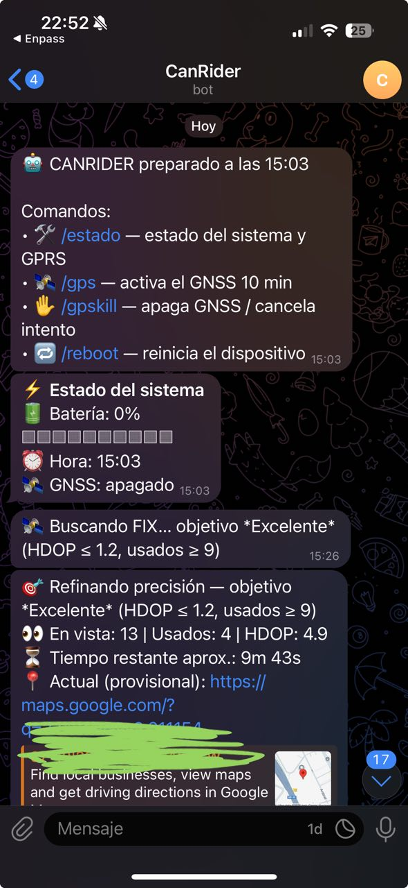

<p align="center">
  
</p>

# CanRider ONE

**CANRider One** es un sistema diseñado para integrar y supervisar datos de motos eléctricas mediante el protocolo **CAN**. Combina simplicidad y funcionalidad, permitiendo:
- Monitorizar el **estado de la batería (SoC)**,
- **Enviar la hora** al bus,
- Registrar datos en **microSD**,
- Control remoto mediante **Telegram**.

Ideal para entusiastas de la tecnología y la movilidad eléctrica, CANRider One ofrece una experiencia optimizada para comprender y mejorar el rendimiento de tu motocicleta.

> Este proyecto está adaptado para **SuperSoco CPX**.

> ⚠️ **Aviso**: Es un proyecto básico. No me hago responsable de posibles daños. En ningún momento el firmware final envía tramas CAN distintas a la hora (enviar otras tramas podría bloquear el BMS). He documentado lo mejor posible el proceso.

Puedes unirte si quieres
https://t.me/+KCIM_fFMSy0yMTBk
---

# CANRider-One · Versión Telegram

He decidido dejar a un lado la [versión de Traccar (consulta aquí)](https://github.com/jichef/CANRider-One/tree/main/CANRider-One-Traccar_Version) porque requiere un mayor desarrollo y aparataje que no era necesario. Quedaba muy bien, pero resultaba engorroso para quienes empiezan de cero. Con **Telegram** se simplifica: le preguntas al bot por la **batería** y la **ubicación**… y listo.

Solo necesitas comprar el **ESP32**, **transceptor**, **carcasa**, **compilar** y **funciona**.

Este firmware permite:
- Enviar mensajes por **Telegram** para consultar **batería** y **ubicación GPS**.
- Recibir y procesar **tramas CAN** del sistema de la moto.
- Optimización básica del consumo energético (**GPS apagado por defecto**, **GPRS** siempre activo pero optimizado).
<p align="center">
  
</p>
---

## 🚀 Características principales

- ✅ Comunicación por **GPRS (HTTPS)** usando `TinyGsmClientSIM7000SSL`.
- ✅ Soporte para **mensajes SMS** entrantes.
- ✅ Lectura de **GPS** bajo demanda.
- ✅ Lectura de **batería del ESP32** y **batería CAN** del vehículo.
- ✅ Gestión remota vía **Telegram bot**.
- ✅ Activación y desactivación de **Bluetooth** mediante comandos.
- ✅ Soporte **TWAI (CAN Bus)** con recepción de tramas.

---

## ⚙️ Hardware necesario

- **ESP32** — p. ej., LilyGO **T7000G** (importante la **G**).
- **Transceptor CAN** [SN65HVD230 u otro compatible](https://www.amazon.es/gp/product/B07VG3Z9GT)  
  - `TX_GPIO = 33`
  - `RX_GPIO = 32`
- **Módem SIM7000G** con tarjeta SIM (APN configurable).
- **MicroSD** (opcional, para logs en JSON).
- **Conversor DC-DC (60V → 5V)** para alimentación desde la moto, sustituyendo la ECU original.
- **Tarjeta SIM** (p. ej. DIGI tiene 2 GB de datos y SMS gratis entre números DIGI).
- **Carcasa impresa**: https://www.thingiverse.com/thing:5861376

---

## 📚 Librerías

Descarga e instala **Arduino IDE** y, desde *Manage Libraries*, instala:

- [TinyGSM](https://github.com/vshymanskyy/TinyGSM)  (incluye `TinyGsmClientSIM7000SSL`)
- [UniversalTelegramBot](https://github.com/witnessmenow/Universal-Arduino-Telegram-Bot)
- **ArduinoJson**
- **ESP32 CAN (TWAI)** — incluido en el core ESP32
- **FreeRTOS** — incluido en el core ESP32
- **SD** — incluido en el core ESP32

---

## 🔌 Conexiones

Del **transceptor**:
- **CAN-H / CAN-L** → bus CPX (conector delantero de la ECU; se añadirán fotos).
- **ESP32 GPIO 33** → TX del transceptor.  
- **ESP32 GPIO 32** → RX del transceptor.  
- **Alimentación**: 5 V al **SIM7000** y al **ESP32** (desde el DC-DC).  
- **GND** del transceptor a **GND** del **SIM7000/ESP32**.

---

## 🛠️ Instalación

1) **Descarga el ZIP** del proyecto.  
2) Abre el proyecto en **Arduino IDE**.  
3) Configura `config_user.h`:

```cpp
#define APN "internet.digimobile.es"  // Ejemplo DIGI
#define BOT_TOKEN "123456:ABC..."     // Token de tu bot de Telegram
#define CHAT_ID  "123456789"          // chat_id autorizado
```

> Nota: crea tu bot y consigue el token con **@BotFather** (hay muchos tutoriales).

4) Compila y **sube** el firmware al **ESP32**.

---

## 📡 Funcionalidades

### 🔋 Estado de batería (SoC)
- Escucha tramas **CAN ID `0x541`**.  
- El primer byte (`data[0]`) indica el **% de batería**.  
- Se muestra por **Telegram** y se registra en **SD** (si está insertada).

### ⏰ Hora
- Se obtiene del módem (**`+CCLK?`**).  
- Se **envía al bus CAN** de forma periódica (cada ~200 ms).

### 📍 GPS
- El **SIM7000** activa **GNSS bajo demanda**.  
- Responde con **enlace de Google Maps** (`/gps`).

### 🗂️ Logs
- Guardados como **`logs_YYYY-MM-DD.txt`** en **SD**.  
- Ejemplo:
```json
{"hora_sistema":"12:34:56","soc":55,"evento":"encendido"}
```

---

## 🤖 Comandos de Telegram

| Comando     | Descripción |
|-------------|-------------|
| `/start`    | Mensaje de bienvenida |
| `/hora`     | Hora actual del sistema |
| `/estado`   | Estado del sistema (SoC, red, hora y barra de batería) |
| `/gps`      | Coordenadas actuales |

> ⚠️ Solo responden los **`chat_id`** autorizados en **lista blanca**.

---

## 🛰️ Detalle de `/gps`

Cuando envías **`/gps`** por Telegram, el sistema:  
1) **Enciende el GNSS** del SIM7000,  
2) Busca **fix** de satélites hasta un **timeout** (≈ 10 min),  
3) **Informa del progreso** cada ~25–30 s (satélites en uso/vista),  
4) Si tras varios intentos no mejora, **relaja criterios** y envía ubicaciones **provisionales** (para que veas el refinado),  
5) Si antes de los 10 min obtiene una localización mejor, **la envía**,  
6) Devuelve **enlace Google Maps** (`lat,lon`) y, si está disponible, **precisión** y datos útiles,  
7) **Apaga GNSS** para **ahorrar energía**.

---

## 🛡️ Seguridad y fiabilidad

- **Lista blanca** de `chat_id`.  
- **Logs críticos** en microSD.  
- **Watchdog** → reinicio del módem ante fallos.  

---

## 📊 Ejemplo en Telegram

```
⚡ Estado del sistema
🔋 Batería: 55%
[█████░░░░░]
📡 GNSS: desactivado
⏰ Hora: 12:34
```

**Con `/gps` →**  
📍 [Abrir en Google Maps](https://maps.google.com/?q=37.123,-3.456)

---

## 🚦 Roadmap

- [x] Envío de hora por CAN  
- [x] Lectura de SoC  
- [x] Control por Telegram  
- [x] Logs en microSD  
- [ ] Geocercas  
- [ ] Panel web con Husarnet  

---

## 📜 Licencia

**MIT License** — libre para usar y modificar.

---

✍️ **Autor:** [@jichef](https://github.com/jichef)  
📌 Proyecto para la **SuperSoco CPX**
